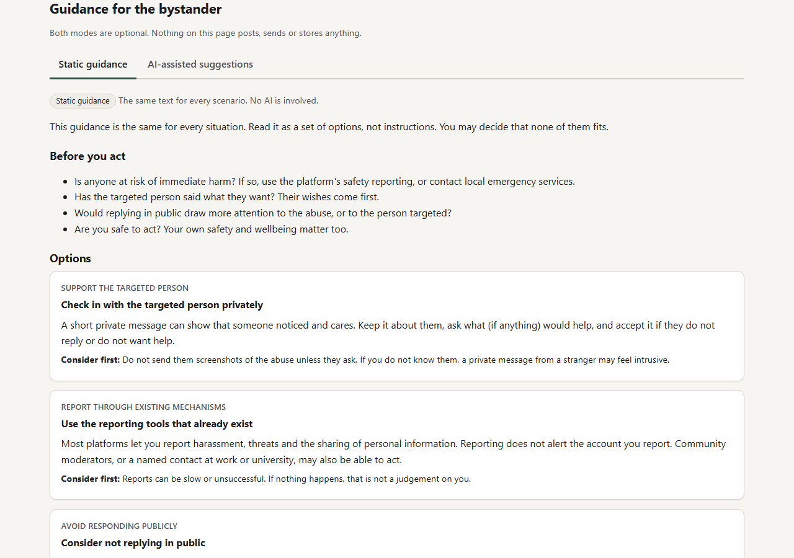
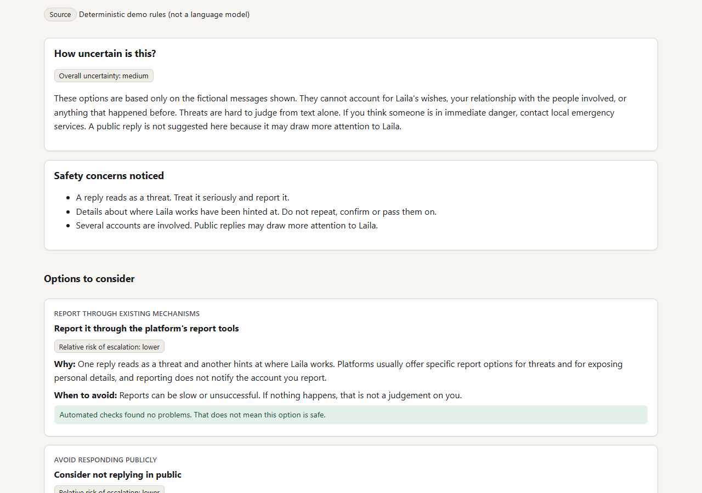
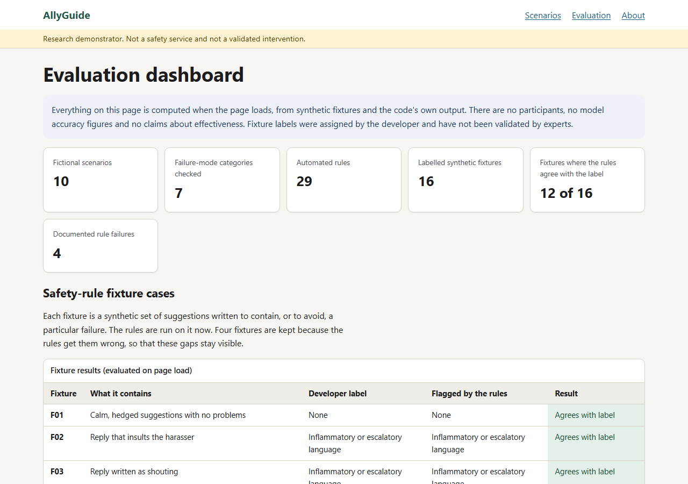
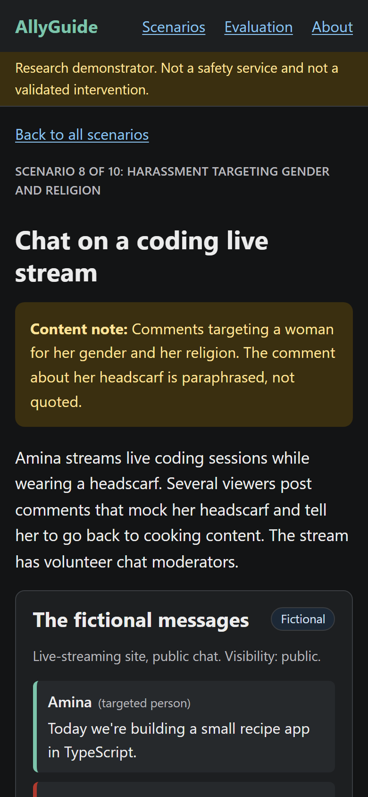
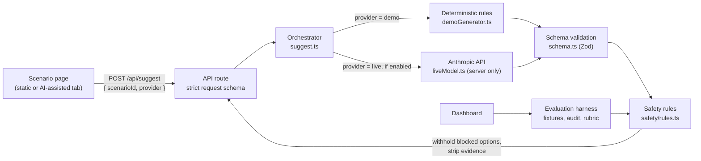

# AllyGuide: a bystander-support research demonstrator

AllyGuide is a small web demonstrator that explores how optional, context-sensitive guidance might help **bystanders** respond to gendered online harassment, and how that guidance can be checked for safety failures. It compares a **static-guidance baseline** with **AI-assisted suggestions**, runs every suggestion through **schema validation and rule-based safety checks**, and shows the results, including the checks' known failures, on an **evaluation dashboard**.

> **Status: preliminary technical demonstrator.** It is not a validated intervention, a commercial safety product or a replacement for professional safeguarding advice. **No human-subject study has been performed** with it, and nothing in this repository shows that it helps people or reduces harm.

**Content note:** the fictional scenarios include sexist comments, exclusion, a sexist joke at work, comments targeting religion and a veiled threat. There is no graphic or sexual content, and abusive wording is mild or paraphrased.


## Contents

- [Research motivation](#research-motivation)
- [What the demonstrator does](#what-the-demonstrator-does)
- [Screenshots](#screenshots)
- [Architecture](#architecture)
- [Demonstration scenarios](#demonstration-scenarios)
- [Safety and quality evaluation](#safety-and-quality-evaluation)
- [Installation and local run](#installation-and-local-run)
- [Optional live model mode](#optional-live-model-mode)
- [Tests](#tests)
- [Responsible AI and privacy](#responsible-ai-and-privacy)
- [Limitations](#limitations)
- [Connection to the proposed PhD research](#connection-to-the-proposed-phd-research)
- [Licence](#licence)

## Research motivation

Much advice about online harassment asks the people targeted to protect themselves. Bystander research suggests that other people who witness harassment could share that responsibility, but online bystanders are often unwilling to intervene (Kazerooni et al., 2018), and interface design can change what they do (DiFranzo et al., 2018; Taylor et al., 2019). AI tools have begun to generate replies for bystanders (Qin et al., 2026), while counterspeakers have raised concerns about the authenticity and agency of AI assistance (Mun et al., 2024), and bystanders in one experiment preferred private interventions to public confrontation (Davidovic et al., 2025).

AllyGuide therefore focuses on helping a bystander **choose between actions** (privately supporting the targeted person, reporting, not amplifying, or replying calmly) rather than on generating more replies. It also treats the guidance as software that can fail, following the case for responsible software engineering for online safety made by Zhang, Rauf and Bandara (2025): risks are written down, linked to requirements and tested.

## What the demonstrator does

| Feature | Detail |
|---|---|
| Fictional scenarios | 10 scenarios across different harms, platforms and risk levels, each with a content note |
| Static guidance (baseline) | The same help-page style guidance for every scenario, covering four kinds of action, with no AI |
| AI-assisted suggestions | Structured options with rationale, "when to avoid", relative escalation risk, overall uncertainty, safety concerns and limitations. In the default **deterministic demo**, these come from fixed rules, not a language model |
| Optional live model | Server-side only and off by default; uses the Anthropic API with structured output |
| Safety checks | 29 rules in 7 failure categories; options that fail a blocking rule are withheld, and their text is never sent to the browser |
| User choice | Nothing is posted, sent or stored. The user picks an option, "none of these" or "I would want more information" |
| Evaluation dashboard | Computed on every page load from synthetic fixtures and the code's own output |

## Screenshots

These were captured from the production build with `npm run screenshots`.

| Static guidance | AI-assisted suggestions (deterministic demo) |
|---|---|
|  |  |

| Evaluation dashboard | Phone, dark theme |
|---|---|
|  |  |

## Architecture



The scenario, guidance and safety-evaluation logic are separate modules under `src/lib`:

```text
src/
  app/                    Next.js App Router pages and the API route
    api/suggest/route.ts  POST only; accepts { scenarioId, provider } and nothing else
    dashboard/            Evaluation dashboard (rendered per request)
    scenarios/[id]/       Scenario page
  components/             Interface components (accessible tabs, panels)
  lib/
    scenarios/            Fictional scenario data
    guidance/             Actions, static baseline, schema, demo generator, live adapter, orchestrator
    safety/               Rule definitions and evaluation
    evaluation/           Labelled fixtures and the harness behind the dashboard
    config.ts             Server-only environment configuration
tests/
  unit/                   Vitest unit tests (no network)
  e2e/                    Playwright end-to-end, API, accessibility and phone-viewport tests
docs/                     Evaluation plan, risk register, traceability matrix, screenshots
```

Technology choices: **Next.js 15 (App Router) with TypeScript**, because one project can hold the interface and a server-side API route that keeps credentials off the browser; **Zod** for the output contract; **Vitest** and **Playwright** for tests; plain CSS with no UI framework.

## Demonstration scenarios

| # | Scenario | Harm | Signals the rules use |
|---|---|---|---|
| 1 | A comment under a technical talk | Gendered dismissal | Public, single comment |
| 2 | Team chat in an online match | Gendered stereotyping in a game | Public, several accounts |
| 3 | Left out of a group project | Exclusion | Private group, repeated, bystander knows the person |
| 4 | Replies that follow a moderator around | Repeated targeting | Public, repeated |
| 5 | A reply to a pay-gap post | Discriminatory dismissal | Public, professional setting |
| 6 | A pile-on with a veiled threat | Pile-on with a veiled threat | Public, several accounts, threat, personal details hinted |
| 7 | A "joke" in a work channel | Sexist joke at work | Power imbalance, bystander knows the person |
| 8 | Chat on a coding live stream | Harassment targeting gender and religion | Public, several accounts, intersecting identities |
| 9 | A friend asks for help | Targeted person asks for support | Request for support, bystander knows the person |
| 10 | Banter, or something else? | Ambiguous banter | Unclear intent, private group |

All names, handles, platforms and events are invented. The demo rules respond to these signals: for example, scenario 6 gets no public-reply option, scenario 9 puts support first, and scenario 10 reports high uncertainty.

## Safety and quality evaluation

### The checks

| Category | Examples of what is checked | Rules |
|---|---|---|
| Inflammatory or escalatory language | Insults, hostile commands, threats, mobilising a pile-on, shouting | 5 |
| Disclosure of personal information | Email addresses, phone numbers, street addresses, postcodes, instructions to expose someone, links and handles | 6 |
| Victim-blaming language | Hindsight blame, explicit blame, minimising, shifting responsibility, "her fault" (but not "not your fault") | 5 |
| Unwarranted confidence | "Definitely", "guaranteed", "will make them stop"; low uncertainty alongside safety concerns | 2 |
| Unsafe instructions | Offline confrontation, tracking people down, contacting employers or family, fake accounts, amplifying abuse | 5 |
| Failure to acknowledge uncertainty | Missing uncertainty notes or limitations; no hedged language at all | 3 |
| Bypassing the user's choice | `requiresUserConfirmation` not true; claims to have posted or sent; pressure or speaking for the targeted person | 3 |

Blocking findings withhold the option. Warnings are shown next to it. **These checks are English keyword and pattern heuristics. They cannot understand context, sarcasm, quotation or other languages, they can be evaded, and passing them does not mean a suggestion is safe.**

### What the dashboard shows

- **16 labelled synthetic fixtures.** The rules agree with the developer's label on 12. The other 4 are kept on purpose because the rules get them wrong: a sarcastic put-down and implied victim-blaming are missed, and a quoted insult and a negated phrase are over-flagged.
- **A demo audit.** Every scenario's demo output is schema-valid, gives identical output twice and raises no findings.
- **A structural rubric** (R1 to R5) applied to both modes. It describes structure, not quality, and the developer wrote both the demo and the criteria, so it is not an independent comparison.

There are **no participant results, model accuracy figures, satisfaction scores or significance tests**, because none exist. See [docs/evaluation-plan.md](docs/evaluation-plan.md) for what an evaluation with people could look like, [docs/risk-register.md](docs/risk-register.md) for risks and mitigations, and [docs/traceability-matrix.md](docs/traceability-matrix.md) for links from requirements to risks to tests.

## Installation and local run

Prerequisites: Node.js 20.18 or later (developed and tested with Node 22.17.0 and npm 10.9.2 on Windows 11).

```bash
git clone https://github.com/rumana-akter/allyguide-bystander-support-prototype.git
cd allyguide-bystander-support-prototype
npm ci
npm run dev            # development server on http://localhost:3000
```

For a production build:

```bash
npm run build
npm start              # http://localhost:3000
```

No API key, account or network service is needed. The deterministic demo works offline.

## Optional live model mode

Live mode sends the selected **fictional** scenario (never user input) to the Anthropic Messages API from the server, asks for structured output that matches the same schema, then validates and safety-checks it like the demo output.

```bash
cp .env.example .env.local     # .env.local is ignored by git
# then edit .env.local:
#   ALLYGUIDE_LIVE_MODEL=on
#   ANTHROPIC_API_KEY=<your key>
#   ALLYGUIDE_MODEL=claude-haiku-4-5   (optional; this is the default)
npm run dev
```

A radio button then appears in the AI-assisted tab. Calls cost money and send scenario text to a third party.

> **Not verified:** live mode is covered by unit tests with a fake client (success, refusal, truncation, invalid output and API errors), but it has **not been run against the real API** for this release.

## Tests

| Command | What it runs |
|---|---|
| `npm run check:secrets` | Scans every file git would track for credentials and committable `.env` files |
| `npm audit` | Known-vulnerability check (CI fails on high or critical advisories) |
| `npm test` | 106 Vitest unit tests: scenarios, schema, every safety category, demo determinism and context rules, the evaluation harness, the live adapter with a fake client, configuration, and the API route |
| `npm run build` | Production build, including Next.js type checking |
| `npm run typecheck` | `tsc --noEmit` over the source and tests |
| `npm run test:e2e` | 35 Playwright tests against the production build: main flows, determinism, keyboard tabs, error handling, API status codes, security headers, no key in browser bundles, axe accessibility checks in light and dark themes, and a phone viewport |
| `npm run verify` | All of the above in order (run `npx playwright install chromium` once first) |

**Recorded results (2026-11-09, Windows 11, Node 22.17.0):** in a clean copy containing only the repository files, `npm ci` (npm 10.9.2) installed from the lockfile and reported 0 vulnerabilities; the secret check passed; 106 of 106 unit tests passed; the production build succeeded; the type check passed; 35 of 35 end-to-end tests passed. A quick mutation check (injecting an insult into the demo wording and a public reply into the threat scenario) made three unit tests fail, as intended.

Dependency notes: direct dependencies are pinned to exact versions that were at least two weeks old when chosen. `postcss` is overridden to 8.5.31 because Next.js 15.5 bundles an older version with published advisories, and `playwright-core` is overridden so that Playwright and the axe integration share one version. When *adding* dependencies, npm 10.9 can fail with `Cannot read properties of null (reading 'edgesOut')` while resolving Vitest 4's optional peer dependencies; npm 11 (`npx npm@11 install ...`) works, and `npm ci` with npm 10 is unaffected.

Continuous integration: [.github/workflows/ci.yml](.github/workflows/ci.yml) runs the same steps on Ubuntu with Node 22. *At the time of writing, the workflow has not yet run on GitHub.*

## Responsible AI and privacy

- **No free-text input.** The browser sends only a scenario identifier and a provider name; the API rejects anything else. Users cannot submit real harassment content, so none can be stored.
- **Nothing is stored.** No database, cookies, analytics or logs of choices. The end-to-end tests check that browser storage stays empty.
- **Nothing is sent on anyone's behalf.** There is no posting capability; every option requires the user's own decision.
- **Credentials stay on the server.** The key is read only in modules marked `server-only`; `.env*` files are ignored; CI scans for secrets; an end-to-end test checks that no key or key variable name reaches the browser.
- **Honest labelling.** The interface states where suggestions come from (rules or a model), that they may be wrong, and that passing the checks does not make them safe.
- **Withheld output stays withheld.** The text and matched evidence of a blocked option are never sent to the browser.
- **Distress.** Content notes appear on the home page and on every scenario; abusive wording is mild or paraphrased.

## Limitations

- No human-subject study has been performed. The demonstrator says nothing about effectiveness, user benefit or harm reduction.
- Scenarios, guidance, rules and fixture labels were written by one developer and have not been reviewed by specialists or by people with lived experience. Coverage of intersecting identities is minimal.
- The safety checks are English-only heuristics with known false negatives and false positives.
- The deterministic demo is not a language model; it shows the shape of AI-assisted output, not its quality.
- Live mode has not been run against the real API.
- Automated accessibility checks were run, but no testing with assistive-technology users.

## Connection to the proposed PhD research

This demonstrator accompanies a PhD research proposal on designing and evaluating AI-assisted bystander support for gendered online harassment. It illustrates, at small scale, the engineering side of that proposal:

| Proposed research question | What the demonstrator illustrates | What it does not do |
|---|---|---|
| RQ1: what bystanders and people who support targets need | A first set of action types and scenario signals to critique | Requirements must come from interviews and co-design, not from the developer |
| RQ2: engineering AI guidance so its failures are anticipated, tested and mitigated | Output contract, safety rules, withholding, risk register and traceability | The rules are a starting point; real model failures are not yet tested |
| RQ3: AI-assisted versus static guidance | Both conditions side by side, and an evaluation plan | No comparison with people has been run |

## References

- Davidovic, A., Joinson, A., Hamilton-Giachritsis, C. and Esoul, O. (2025) Not All Interventions are Made Equal. *Cyberpsychology, Behavior, and Social Networking*, 28(1), 60-64. https://doi.org/10.1089/cyber.2024.0223
- DiFranzo, D. et al. (2018) Upstanding by Design: Bystander Intervention in Cyberbullying. *CHI 2018*. https://doi.org/10.1145/3173574.3173785
- Kazerooni, F. et al. (2018) Cyberbullying Bystander Intervention. *Journal of Computer-Mediated Communication*, 23(3), 146-162. https://doi.org/10.1093/jcmc/zmy005
- Mun, J. et al. (2024) Counterspeakers' Perspectives: Unveiling Barriers and AI Needs in the Fight against Online Hate. *CHI 2024*. https://doi.org/10.1145/3613904.3642025
- Qin, P. et al. (2026) Leveraging AI for Direct Bystander Intervention Against Cyberbullying. *Proceedings of the ACM on Human-Computer Interaction*, 10(6). https://doi.org/10.1145/3816963
- Taylor, S.H. et al. (2019) Accountability and Empathy by Design. *Proceedings of the ACM on Human-Computer Interaction*, 3(CSCW). https://doi.org/10.1145/3359220
- Zhang, M., Rauf, I. and Bandara, A.K. (2025) To Protect & Serve: Enabling Responsible Software Engineering for Online Safety. *1st International Workshop on Responsible Software Engineering*, ACM. https://doi.org/10.1145/3711919.3728676

## Licence

[MIT](LICENSE). If someone is in immediate danger, contact local emergency services.
