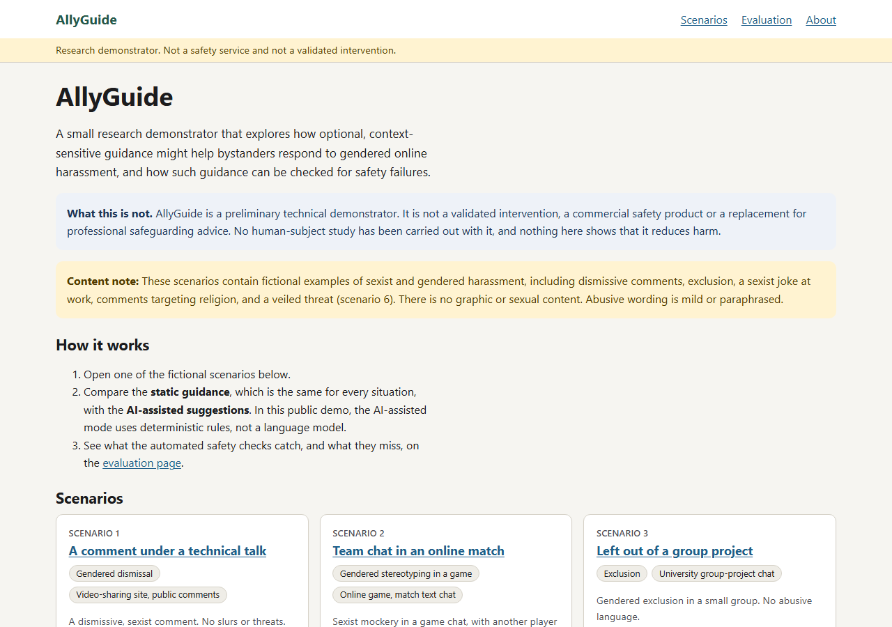

# AllyGuide — Bystander Support Prototype

AllyGuide is a small web prototype exploring how someone who witnesses gendered online harassment might be supported in choosing a response. I built it as a starting point for thinking about software safety and testing in the proposed PhD research.



## What it does

- Presents **10 fictional scenarios** involving different forms of online harassment.
- Shows **static guidance** alongside suggestions tailored to each scenario.
- Offers possible actions such as private support, reporting, avoiding amplification or a careful reply. It does not post anything on a user's behalf.
- Uses structured outputs and simple rule-based checks to flag or withhold some potentially unsafe suggestions.
- Includes a dashboard showing results from synthetic test cases, along with automated unit and browser tests.

The default suggestion mode uses **predefined rules, not a language model**. There is also an optional server-side language-model integration, disabled by default and not yet verified against the real API.

## Run locally

Requires Node.js 20.18 or later.

```bash
git clone https://github.com/rumana-akter/allyguide-bystander-support-prototype.git
cd allyguide-bystander-support-prototype
npm ci
npm run dev
```

Open `http://localhost:3000`.

Run unit tests with `npm test`. The project also includes Playwright browser tests (`npm run test:e2e`).

## Current limitations

This is an early technical demonstration, **not a tested online-safety intervention**. There have been no participant studies or specialist reviews, so it does not establish whether the suggestions help people or reduce harm. The safety checks rely on English keywords and patterns and can miss unsafe content or flag harmless text. All scenarios are fictional, and the site does not accept free-text harassment reports.

The code illustrates some starting ideas for the proposed research: comparing guidance approaches, identifying risks and testing how the software handles them. The research questions, user needs and effectiveness would still need to be investigated.
